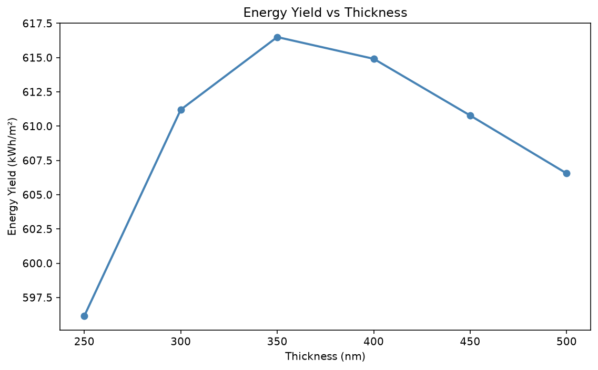
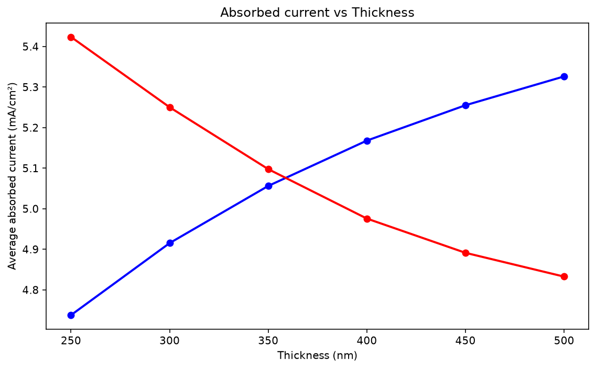
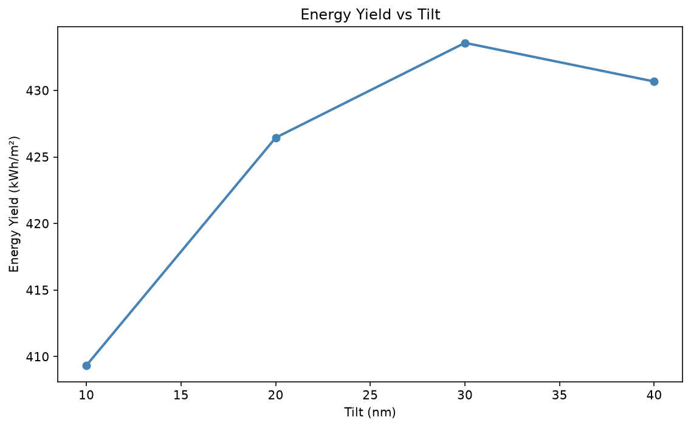
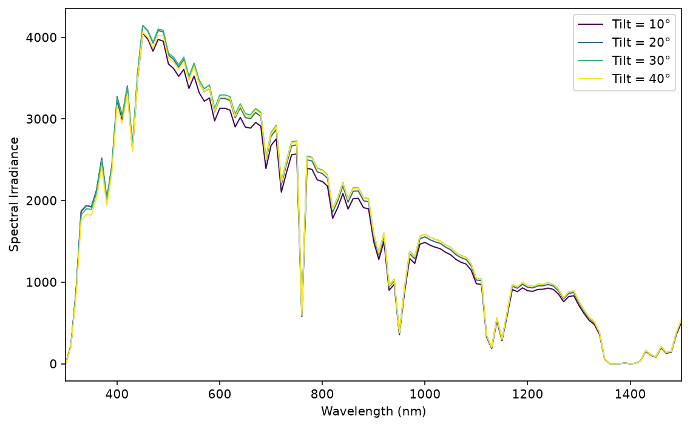

Examples
========

This page shows two example studies that demonstrate how to use the
modelling framework. Each example includes the Python script used to run the
study and the main results.

.. contents:: On this page
   :local:
   :depth: 2

Example 1: Title of the first study
-----------------------------------

Short description of the first study. Explain the goal, the device or module
that is simulated, the location and the main settings that are used.

Python code
~~~~~~~~~~~

The script below runs the study. The file is stored in
``docs/example_scripts/examprunExampleVaryThicknessle_1.py``.

.. literalinclude:: example_scripts/runExampleVaryThickness.py
   :language: python
   :linenos:
   :caption: runExampleVaryThickness.py

You can also download the script: :download:`runExampleVaryThickness.py <example_scripts/runExampleVaryThickness.py>`.

Results
~~~~~~~

   Description of the first figure of example 1. Explain what is shown on
   the axes and what the main conclusion is.

   Description of the second figure of example 1. Explain what is shown on
   the axes and what the main conclusion is.

Example 2: Title of the second study
------------------------------------

Short description of the second study. Explain the goal, how it differs from
the first example, and which settings or parameters are changed.

Python code
~~~~~~~~~~~

The script below runs the study. The file is stored in
``docs/example_scripts/runExampleVaryTilt.py``.

.. literalinclude:: example_scripts/runExampleVaryTilt.py
   :language: python
   :linenos:
   :caption: runExampleVaryTilt.py

You can also download the script: :download:`runExampleVaryTilt.py <example_scripts/runExampleVaryTilt.py>`.

Results
~~~~~~~

   Description of the first figure of example 2. Explain what is shown on
   the axes and what the main conclusion is.

   Description of the second figure of example 2. Explain what is shown on
   the axes and what the main conclusion is.
