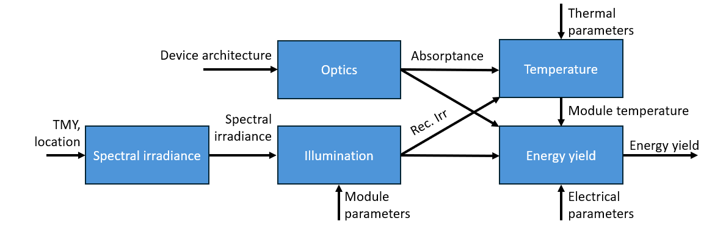

Methodology
===========

The modelling framework calculates the energy yield of a photovoltaic (PV)
module by chaining together five models. Each model takes the output of the
previous ones, plus its own set of input parameters, and passes its results
on. This modular structure makes it easy to see how each physical process
contributes to the final result, and to swap or refine a single model
without touching the others.

   Overview of the modelling framework.

Overview
--------

The workflow starts from meteorological data and ends with the energy yield
of the module:

1. The **spectral irradiance model** converts a typical meteorological year
   (TMY) and a location into spectral irradiance data.
2. The **illumination model** uses the spectral irradiance and the module
   parameters to determine the irradiance received by the module.
3. The **optical model** uses the device architecture to calculate the
   absorptance of the device.
4. The **thermal model** uses the absorptance, the received irradiance and
   the thermal parameters to calculate the module temperature.
5. The **electrical model** combines the absorptance, the received
   irradiance, the module temperature and the electrical parameters to
   calculate the energy yield.

Models
------

Spectral irradiance model
~~~~~~~~~~~~~~~~~~~~~~~~~

The first step takes a TMY and the location of the module as input. From
these, it computes the spectral irradiance, that is, the distribution of
the incoming solar power over wavelength, for every time step in the TMY.
This spectral resolution matters because the performance of PV devices,
especially multi-junction devices, depends on the spectrum of the incident
light.

Illumination model
~~~~~~~~~~~~~~~~~~

The illumination model translates the spectral irradiance into the
irradiance that actually reaches the module. It takes the module parameters
(for example its orientation and tilt) into account. Its output is passed to
both the thermal and the electrical model.

Optical model
~~~~~~~~~~~~~

The optical model takes the device architecture (the layer stack and its
optical properties) as input and calculates the absorptance, that is, the
fraction of light absorbed in the device as a function of wavelength. The
absorptance is used by the thermal model to determine how much heat is
generated, and by the electrical model to determine how much current can be
generated.

Thermal model
~~~~~~~~~~~~~

The thermal model calculates the module temperature. Its inputs are the
absorptance from the optical model, the received irradiance from the
illumination model and a set of thermal parameters. The resulting module
temperature affects the electrical performance, so it is passed on to the
electrical model.

Electrical model
~~~~~~~~~~~~~~~~

The electrical model is the final step. It combines the absorptance, the
received irradiance, the module temperature and a set of electrical
parameters to calculate the electrical output of the module. Summed over
the full TMY, this gives the energy yield.
