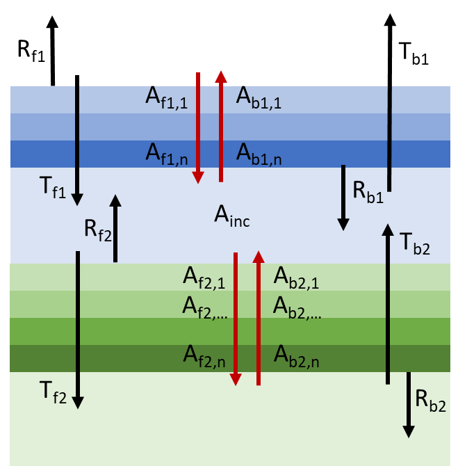
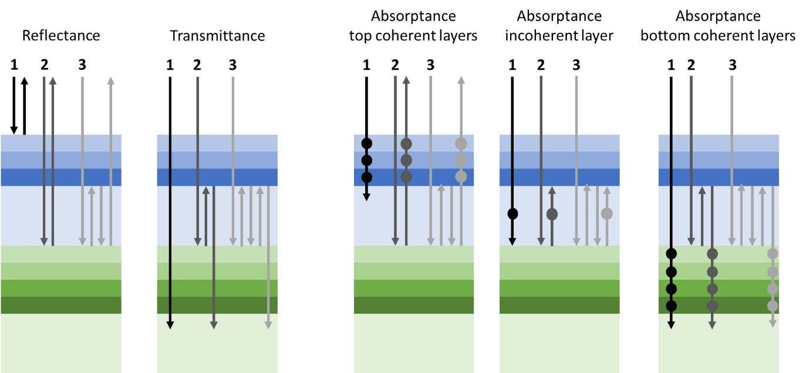
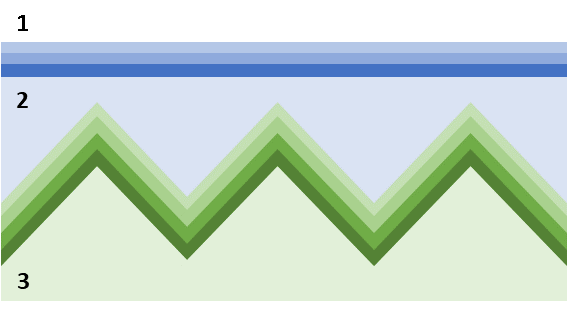

Optics module
=============

The optics module calculates the spectrally and angular-resolved absorptance
for a variety of different architectures of single or multi-junction solar
cells. It is able to handle multiple planar and textured interfaces with
coherent and incoherent light propagation by combining the transfer matrix
method (TMM) and geometrical ray-tracing.

First, the defined architecture is analyzed and divided into optically thin
(coherent) partial stacks and optically thick (incoherent) layers. In this
regard, a coherent layer stack is defined by two incoherent boundary layers.
The light propagation and absorption in any incoherent layer separating two
of such partial stacks is treated with the Beer-Lambert law, with which the
absorption is calculated. For multiple adjacent incoherent layers, the
transmittance and reflectance at their interfaces are calculated with the
Fresnel equations.

For each partial stack and for each incoherent layer the reflectance,
transmittance and absorption in forward and in backward direction are
determined. All these quantities are spectrally resolved.

In order to calculate the total reflectance, transmittance and the
absorptance in each layer, these quantities are connected by subsequently
adding partial stacks or incoherent layers. A simple example is illustrated
in the figure. Here, two partial stacks consisting of 3 and 4 coherent layers
are connected. The properties: reflectance R and transmittance T for the
coherent layers and the absorptance A for the coherent layers for light
propagating in forward and backward direction are shown. In addition, the
absorptance :math:`A_{inc}` in the incoherent layer is shown, at which the
stacks are merged.

First, reflectance is derived by following the ray interactions (see above
figure) within the joined stack. The total reflectance is then the sum over
the individual paths:

.. math::

   R_f = R_{f1} + T_{f1}\left[\ldots\right]T_{b1}
   + \sum_{j}{T_{f1}\left(\left[\ldots\right]R_{b1}\right)^j
   \left(\left[\ldots\right]T_{b1}\right)}

Where we use the following abbreviation:

.. math::

   \left[\ldots\right] = \left(1-A_{inc}\right)R_{f2}\left(1-A_{inc}\right)

Next, the transmittance is derived in an analogous way, which leads to:

.. math::

   T_f = T_{f1}\left(1-A_{inc}\right)T_{f2}
   + \sum_{j}{T_{f1}\cdot\left(\left[\ldots\right]R_{b1}\right)^j
   \left(1-A_{inc}\right)T_{f2}}

Finally, the absorptance is calculated. Here, three cases need to be
distinguished. The absorptance in the coherent layers of the first partial
stack (=top):

.. math::

   A_f\left(f_1,1..n\right) = A_{f1}
   + T_{f1}\left[\ldots\right]A_{b1}
   + \sum_{j}{T_{f1}\left(\left[\ldots\right]R_{b1}\right)^j
   \left(\left[\ldots\right]A_{b1}\right)},

the absorptance of the incoherent layer connecting the two partial stacks:

.. math::

   A_f\left(i\right) = T_{f1}A_{inc}
   + T_{f1}\left(1-A_{inc}\right)R_{f2}A_{inc}
   + \sum_{j}{T_{f1}\left(\left[\ldots\right]R_{b1}\right)^jA_{inc}
   + T_{f1}\left(\left[\ldots\right]R_{b1}\right)^j
   \left(1-A_{inc}\right)R_{f2}A_{inc}},

and the absorptance in the coherent layers of the second partial stack
(=bottom):

.. math::

   A_f\left(f_2,1..n\right) = T_{f1}\left(1-A_{inc}\right)A_{f2}
   + \sum_{j}{T_{f1}\left(\left[\ldots\right]R_{b1}\right)^j
   \left(1-A_{inc}\right)A_{f2}}.

The advantage of this approach is, that for each of the incoherent layers,
defined within the full stack, it is possible to add a texture. The texturing
can be done by setting the morphology for each incoherent layer. The
texturing then is added at the interface between this incoherent layer and
the above layer(s) / layer stack. In the above architecture with 3 incoherent
layers, texturing the last (3) incoherent layer will lead to the following
scenario:

.. note::

   Since texturing of the first (1) incoherent layer facing upwards makes no
   sense, the input of the morphologies starts at the second (2) layer: e.g.
   ``{'Flat', 'Texture'}``.

In order to use a specific texture, either the redistribution matrices for
R, A and T need to be a known property, or they will be calculated by the use
of path data extracted from
`OPAL2 <https://www2.pvlighthouse.com.au/calculators/OPAL%202/OPAL%202.aspx>`__.

The geometrical ray-tracing as described by Baker-Finch and McIntosh is an
elegant approach that allows fast calculation of the characteristic paths for
textures (e.g., pyramids). This gives us a limited set of paths with its
probabilities and their intersection angles.
